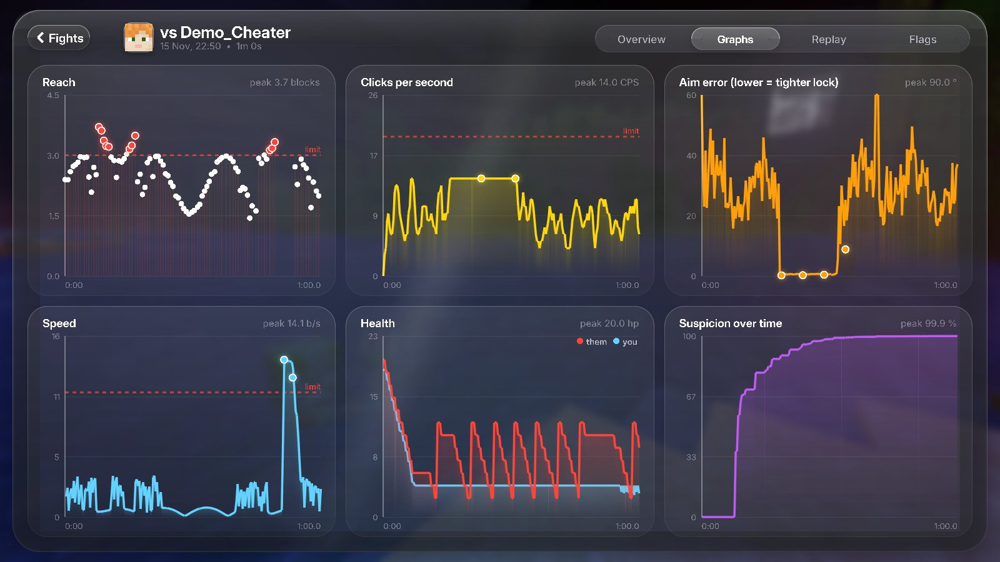

# PvP Mod (Fabric, Minecraft 1.21.11)

Client-side only. Open settings with /pvpmod in chat. Config: config/pvpmod.json

- Items: click any item for its own screen: colour picker, preview, size, and "Edit texture...".
- Texture editor: pixel editor with animation frames. "Apply + reload" writes the resource pack
  resourcepacks/PvPMod Textures (enable it once in Options > Resource Packs) and reloads.
- Armor Colours: tint a whole armor set (leather, chainmail, iron, gold, diamond, netherite, turtle, elytra).
- End crystal: 3D on/off, bedrock base on/off.
- Totem pop: hide the on-screen totem, hide/resize/thin out/recolour the particles.
- Particles: master switch, global size and amount, plus show/hide, size and amount per particle type.

Build: push to GitHub; the Actions tab builds the jar (artifact "pvpmod-jar", use the one without -sources).
The colour tints live in their own mixin config (pvpmod.tint.mixins.json). If one fails to apply,
the rest of the mod still loads.

## Fight Analyzer (1v1 anti-cheat)

Press **J** (or `/pvpmod fights`, or the "Fight Analyzer" button in `/pvpmod`) to open it.
Every 1v1 is recorded automatically: the recording starts the first time you hit a player or a player hits
you, and stops when someone dies, they leave, or nobody hits for 20 seconds (changeable in Settings).
While recording, a "dynamic island" at the top of the screen shows the opponent, the live suspicion score,
and each new flag as it happens.

Each fight gets a report with four tabs:

- **Overview**: suspicion ring (0-100%), verdict, a score per check and fight stats (max/avg reach, peak CPS, hits, pops).
- **Graphs**: reach per hit, CPS, aim error, speed, health of both players and suspicion over time. Flags are marked
  on the lines. Click any graph to jump to that moment in the replay.
- **Replay**: a 3D reconstruction of the fight with both players drawn as real models wearing their skins (walking, arm swings on hits, head pitch) (orbit, top-down, or **their eyes**, which shows what the opponent
  was looking at). Hitboxes, look rays, hit lines with the measured reach, totem pops and a pin at every flagged
  moment. The timeline shows every flag; `F` jumps to the next one, space plays, arrow keys step a tick.
- **Flags**: every suspicious moment in order, with the measured value. Click one to watch it.

Checks (all done from what your client can see; nothing is sent to the server):

| Check | What it looks for |
|---|---|
| Reach | Melee hits from further than 3.0 blocks, measured eye-to-hitbox with both pings allowed for |
| Killaura | Hits while looking far away from you; snapping onto you to hit and snapping back |
| Aim assist | Crosshair locked on you while you strafe faster than a human can track |
| Autoclicker | 20+ CPS for 2+ seconds, or CPS so even it can't be a human |
| Anti-knockback | Not moving back after your hits, with open space behind them (holes/walls are ignored) |
| Speed | Faster than sprint-jumping, ignoring knockback, explosions, pearls, elytra, water |
| Flight | Floating or rising with nothing below them, ignoring gravity |
| Auto totem | A new totem in hand faster than human reaction time after a pop (their ping is subtracted) |
| Crystal aura | Crystals placed and broken at inhuman speed, or placed without looking |
| Through walls | Hits with solid blocks between their eyes and your hitbox |

`/pvpmod demo` creates a simulated fight against a cheater so you can try the screens without a real fight.
`/pvpmod analyze <name>` only records fights with that player (`/pvpmod analyze off` to undo), `/pvpmod stop` ends
the current recording.

Fights are saved in `.minecraft/pvpmod/fights` (gzip JSON, the newest 50 are kept). The score is evidence, not proof:
lag spikes and server plugins (custom knockback, custom reach) can cause flags, so use Sensitivity in Settings
(Strict / Normal / Relaxed) and watch the replay before reporting someone.

The UI uses the Inter font (SIL Open Font License, see `src/main/resources/assets/pvpmod/font/inter_license.txt`).
New code lives in `src/main/java/dev/pvpmod/analyzer` and `src/main/java/dev/pvpmod/glass` (the glass UI toolkit).
