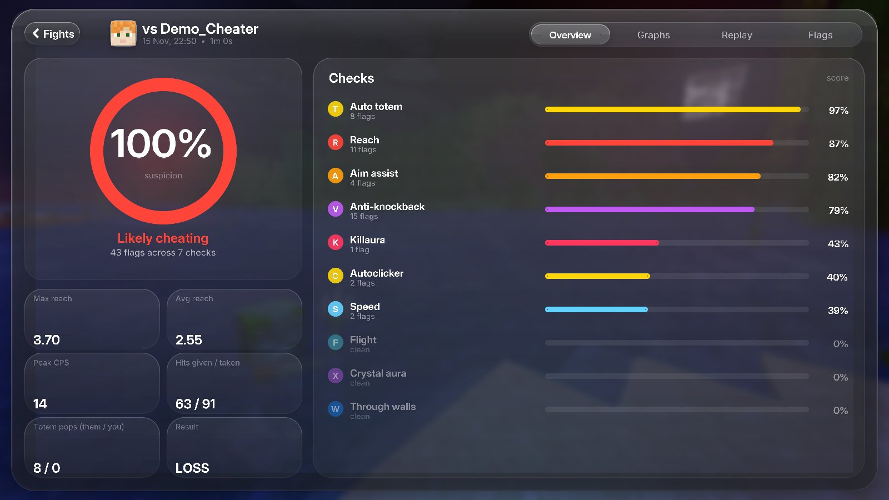
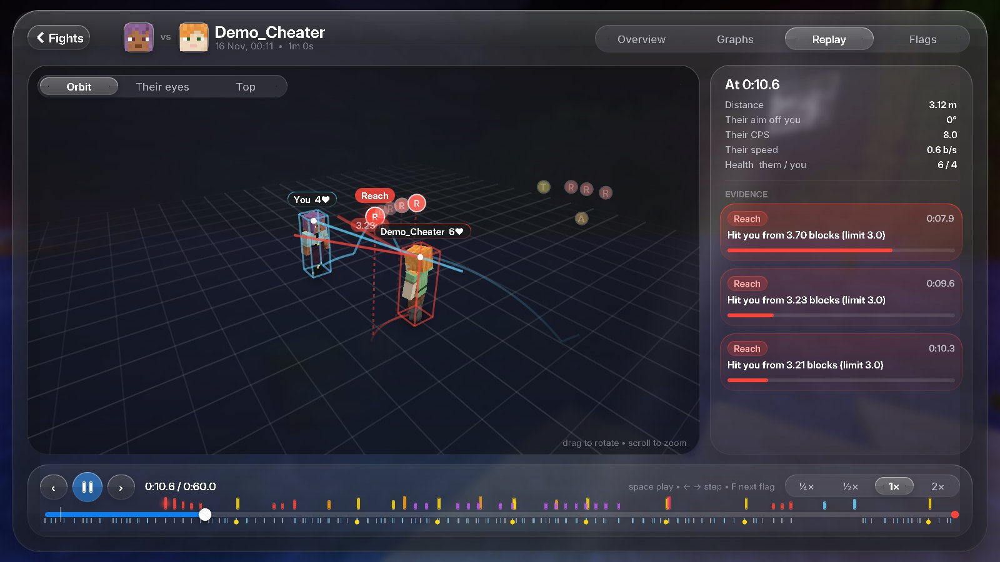
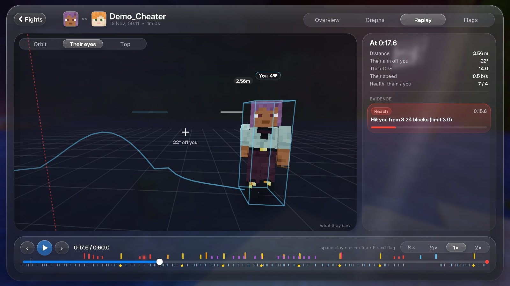
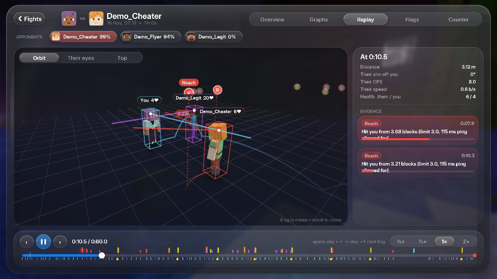
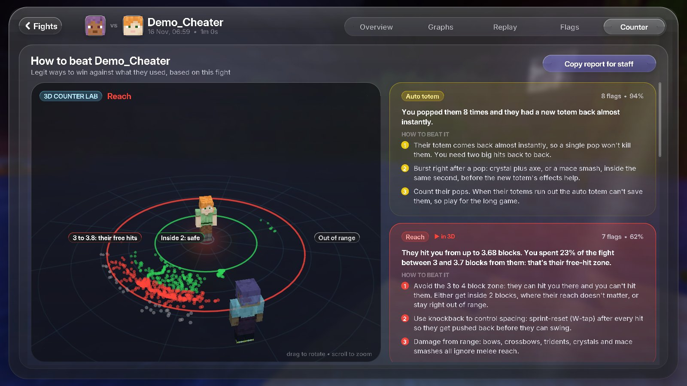
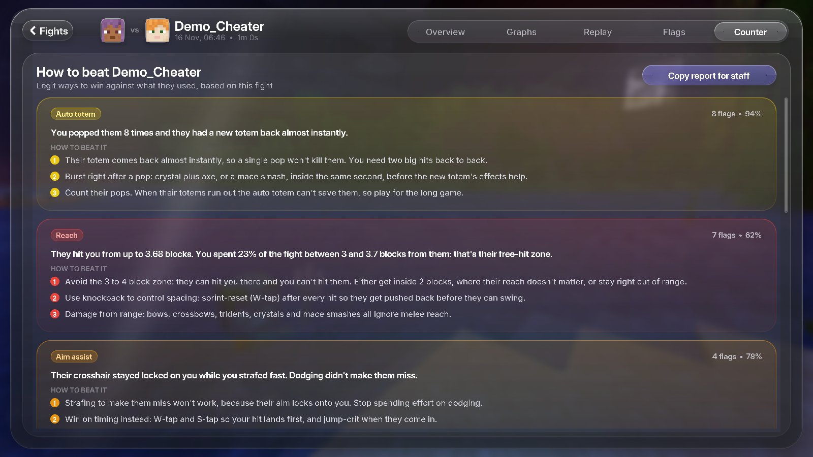

# PvP Mod (Fabric, Minecraft 1.21.11)

Client-side only. Open settings with /pvpmod in chat. Config: config/pvpmod.json

- Items: click any item for its own screen: colour picker, preview, size, and "Edit texture...".
- Texture editor: pixel editor with animation frames. "Apply + reload" writes the resource pack
  resourcepacks/PvPMod Textures (enable it once in Options > Resource Packs) and reloads.
- Armor Colours: tint a whole armor set (leather, chainmail, iron, gold, diamond, netherite, turtle, elytra).
- End crystal: 3D on/off, bedrock base on/off.
- Totem pop: hide the on-screen totem, hide/resize/thin out/recolour the particles.
- Particles: master switch, global size and amount, plus show/hide, size and amount per particle type.

Build: push to GitHub; the Actions tab builds the jar (artifact "pvpmod-jar", use the one without -sources).
The colour tints live in their own mixin config (pvpmod.tint.mixins.json). If one fails to apply,
the rest of the mod still loads.

## Fight Analyzer (1v1 anti-cheat)

Press **J** (or `/pvpmod fights`, or the "Fight Analyzer" button in `/pvpmod`) to open it.
Every fight is recorded automatically, against up to **4 opponents at once** (2v2s, FFAs, getting teamed): the recording starts the first time you hit a player or a player hits
you, and stops when someone dies, they leave, or nobody hits for 20 seconds (changeable in Settings).
While recording, a "dynamic island" at the top of the screen shows each opponent (one row per player) with their
live suspicion score, and each new flag as it happens.

Group fights: every opponent gets their own recording and cheat analysis, judged only on what they did to you
(hits from teammates or other players count as knockback/explosions, not as yours). Fights that overlap are saved
as one group: the list shows a single card with everyone's heads and scores, the report has a row of opponent
pills to switch between them, and the replay shows all the fighters at once (the one you're looking at in red,
the others in purple). `/pvpmod demo4` or "Try a 4-player demo" shows a fight against three players at once.

Each fight gets a report with four tabs:

- **Overview**: suspicion ring (0-100%), verdict, a score per check and fight stats (max/avg reach, peak CPS, hits, pops).
- **Graphs**: reach per hit, CPS, aim error, speed, health of both players and suspicion over time. Flags are marked
  on the lines. Click any graph to jump to that moment in the replay.
- **Replay**: a 3D reconstruction of the fight with both players drawn as real models wearing their skins (walking, arm swings on hits, head pitch) (orbit, top-down, or **their eyes**, which shows what the opponent
  was looking at). Hitboxes, look rays, hit lines with the measured reach, totem pops and a pin at every flagged
  moment. The timeline shows every flag; `F` jumps to the next one, space plays, arrow keys step a tick.
- **Flags**: every suspicious moment in order, with the measured value. Click one to watch it.
- **Counter**: a 3D Counter Lab plus a coach for beating them. The lab is a holographic arena where their model
  (their skin) stands in the middle and a ghost of you (your skin) acts out the counter, on top of your real fight
  data: reach shows coloured danger rings with every spot you stood as a heat map, killaura a sweeping aura radar with
  X marks where they hit you without looking, aim assist a lock-on laser that a pillar breaks, autoclicker a 3D bar
  ring of their CPS over the fight, anti-knockback where they should have flown vs where they stayed, plus scenes for
  speed (cobwebs), flight (bow from the ground), auto totem (pop/refill timeline and the two-hit burst), crystal aura
  (hole + high ground) and wall hits. Drag to rotate, scroll to zoom, click a card to switch scene.
  Next to it, For every cheat it found it shows what they did to you, in numbers from
  this fight (e.g. "you spent 23% of the fight in their 3 to 3.7 block free-hit zone"), and three legit ways to beat it,
  plus a breakdown of your own fight (hit trade, spacing, totem pops). "Copy report for staff" puts a timestamped
  evidence summary on your clipboard to paste into a report.

During a fight the island at the top shows each new flag, then a quick tip on how to counter it.

Checks (all done from what your client can see; nothing is sent to the server):

| Check | What it looks for |
|---|---|
| Reach | Melee hits from further than 3.0 blocks, against the closest you were during their whole ping window |
| Killaura | Hits while looking 75°+ away from you; snapping onto you to hit and snapping back to where they were looking |
| Aim assist | Crosshair locked on you (within 2°) while you strafe faster than a human can track, for most of 5 seconds |
| Autoclicker | 30+ CPS for 2+ seconds (drag clicking stays under this), or CPS so even it can't be a human |
| Anti-knockback | Not pushed back and not lifted by your hits, with open space behind them |
| Speed | Faster than 13 blocks/s for over a second, ignoring knockback, explosions, pearls, elytra, tridents, wind charges, ice |
| Flight | Hovering or rising with nothing below them for over a second, while their position keeps updating |
| Auto totem | A new totem in hand faster than human reaction time after a pop, after taking away their ping |
| Crystal aura | 30+ crystals in 5 s broken as soon as their ping allows, or placed without looking |
| Through walls | Hits with blocks in the way of every spot they could have seen you |

How it avoids false flags, especially with laggy opponents:

- **Their ping is always counted in their favour.** For reach, aim and wall hits it looks back over everywhere you were
  during their ping (plus 20% for jitter and the game's smoothing), and uses the highest ping seen recently. For reaction
  times (totems, crystals) it uses their *lowest* recent ping, so an out-of-date tab-list ping can't make them look faster.
- **Lag spikes are skipped.** When their position freezes and then jumps, they disappear, or a ping spike hits,
  nothing around that moment is judged.
- **High ping counts for less.** Above 250 ms combined ping, reach, aim and killaura evidence counts 30% less (50% above 400 ms).
- **One weird moment isn't enough.** A check with a single flag only counts at about half strength; it takes repeated
  flags to push the score up.
- Each moment is judged one second late, so the analyzer can see what happened right after it (knockback, totem refills).

`/pvpmod demo` creates a simulated fight against a cheater so you can try the screens without a real fight.
`/pvpmod analyze <name>` only records fights with that player (`/pvpmod analyze off` to undo), `/pvpmod stop` ends
the current recording.

Fights are saved in `.minecraft/pvpmod/fights` (gzip JSON, the newest 50 are kept). The score is evidence, not proof:
lag spikes and server plugins (custom knockback, custom reach) can cause flags, so use Sensitivity in Settings
(Strict / Normal / Relaxed) and watch the replay before reporting someone.

The UI uses the Inter font (SIL Open Font License, see `src/main/resources/assets/pvpmod/font/inter_license.txt`).
New code lives in `src/main/java/dev/pvpmod/analyzer` and `src/main/java/dev/pvpmod/glass` (the glass UI toolkit).
