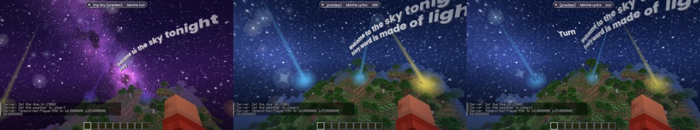

# Markie Lyrics (Fabric, Minecraft 1.21.11)

Live **Spotify lyrics in 3D in your Minecraft sky**. Words pop in one by one as they're sung,
lines curve and tilt across the sky, and a little now-playing pill sits at the top of your screen.
Client-side only, so it works on any server.

## Features
- **Cinematic look (default), like the music-video style:** heavy white lettering with a solid 3D extruded edge,
  colours that match the sky, words that fade in softly and settle, lines angled so they run from far to near,
  lines that slowly fly towards you, two-line pairs that stack and leave together, and a "now playing" title
  card in the sky when a song starts. Presets: **Cinematic**, **Sparkle** (all the effects), **Minimal**
- **The world reacts to the music:** a beat engine works out the tempo from the sung words (or listens to a real
  audio device such as Stereo Mix). On each beat the sky and fog pulse, particles swell and dance, a concert
  light show of coloured beams sweeps and flashes around you, the lyrics bounce, the screen edges glow, and
  (optional) the camera kicks. Live BPM meter in the Atmosphere tab
- **3D lyrics:** letters have a solid 3D body in the world, plus Flip 3D and Tumble 3D pop-ins that turn words
  in real 3D so you see their depth
- A smoothed song clock, so words never jitter when Spotify's position updates
- **3 places to show lyrics:** *Sky* (huge, written into the sky), *Floating* (in front of you, good for PvP),
  *Screen* (subtitle style)
- **Word by word** or whole-line reveal, with pop/fade/rise animations
- **Position controls** (Lyrics tab): distance in blocks for Sky (16-128) and Floating (2-24), height above the
  horizon / your view, left-right spread, subtitle height for Screen mode, "stay in front of fog" and
  "shrink with distance"
- **Follow view**, curved lines, show-through-blocks, timing offset
- **Colours:** 10 themes, **Custom** (your own start / end / glow colours with a colour picker), **Rainbow**
  (flowing hues, speed + spread), **Album** (colours taken from the song's cover), and opacity
- **Effects:** 6 pop-in styles (Pop, Bounce, Zoom, Spin, Slide, Fade), flash echo, shimmer, wave, and
  particle bursts on every word (Sparkles, Stars, Hearts, Notes, Glitter) with an amount slider.
  The Colours and Effects tabs show a live preview
- **Pop-up VFX:** bloom flash and lens flare as each word lands, shockwave rings, a light streak across every
  new line, a soft aura behind the words, karaoke highlight on the word being sung, and letter-by-letter
  reveals
- **Exit animations:** Fade up, Dissolve (words break into glitter), Blow away, Shrink, Drop
- **Atmosphere:** particles drifting around you (Fireflies, Stardust, Snow, Petals, Embers) with density,
  size and lyric-colour tint, plus screen mood: coloured vignette, haze, a glow pulse on each new line and
  cinematic bars. Fades out when the music is paused
- **Skies:** 12 custom skyboxes made by the mod (Galaxy, Aurora, Nebula, Sunset, Golden Hour, Cotton Candy,
  Blood Moon, Ringed Planet, Hyperspace, Clear Day, Starry Night, Lavender Dusk) with brightness, slow
  rotation, keep sun & moon, hide clouds, and fog that matches the sky
- **7 fonts** (Poppins, Montserrat, Fredoka, Bebas Neue, Pacifico, Caveat, Minecraft), size, glow, shadow
- **Now-playing HUD:** cover art, scrolling title, bouncing equaliser bars, progress line
- **Liquid glass menu:** frosted see-through panels over the blurred world, glossy rims, a light that follows
  your mouse, and a liquid tab highlight / toggle knobs that stretch and wobble as they move
- Its own sounds (hover ticks, clicks, toggle chimes, open/close swooshes)
- Play / pause / skip from the menu (Spotify Premium needed for those)
- **Preview mode** with a built-in demo song, so you can try every look without Spotify

## Using it
1. Put `markielyrics-1.7.0.jar` and Fabric API in your `mods` folder.
2. In game press **Right Shift** (or type `/lyrics`) to open the menu.
3. Play a song in the **Spotify desktop app**. That's it: by default (Source: **Auto**) the mod reads what the
   Spotify app on your computer is playing, with no login and no Premium needed
   (Windows: system media controls, macOS: the Spotify app, Linux: needs `playerctl`).
4. Optional, the **Web API** (also follows the Spotify phone app): in the Spotify tab, follow the steps to make a
   developer app and press Connect. **Since February 2026 Spotify only allows this if the account that created the
   developer app has Spotify Premium**, and other accounts must be added under User Management. Without that, every
   request fails with "403"; the menu shows Spotify's exact message, and Auto falls back to the desktop app.

Commands: `/lyrics`, `/lyrics connect`, `/lyrics toggle`, `/lyrics distance <blocks>`.
Unbound keys in Controls: "Toggle lyrics", "Lyrics closer", "Lyrics farther".

Settings are saved in `config/markielyrics.json`. Your Spotify login (a refresh token) is stored there too,
so don't share that file.

## Where the lyrics come from
Spotify's own lyrics aren't available through its public API, so the mod looks the song up on
[LRCLIB](https://lrclib.net), a free database of time-synced lyrics. Most popular songs are there; if a song
has no synced lyrics the menu shows "No synced lyrics".

## Building
Push to GitHub and the Actions tab builds it (artifact **markielyrics-jar**, use the jar without `-sources`).
Locally: `cd lyrics && gradle build` (Gradle 9.2, Java 21).

Fonts are from Google Fonts under the SIL Open Font License (see `assets/markielyrics/font/fonts_license.txt`).
The UI sounds were synthesised for this mod.
